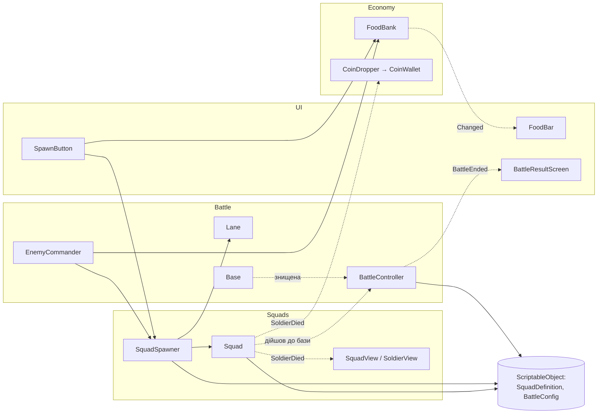

# Архітектура

> **Навіщо.** GDD описує, *що* відбувається в грі, а цей документ описує, *з яких частин* складається код
> і *хто з ким говорить*. Читай його перед тим, як додавати новий скрипт: він підкаже, в яку систему
> скрипт належить і з чим йому можна мати зв'язок.
> Документ описує цільову картину для Етапів 1–2. Коли код розходиться з документом, оновлюємо документ.

Оновлено: 2026-10-20 · Спирається на D-001, D-002, D-004.

---

## 1. Принципи

1. **Загін це логіка, солдати це візуал (D-001).** HP, шкоду, рух і вибір цілі рахує загін.
   Солдати лише показують те, що вирішив загін.
2. **Дані окремо від коду (D-004).** Характеристики живуть у ScriptableObject-ах. Новий тип загону
   означає новий файл даних, а не новий скрипт.
3. **Залежності явні.** Посилання передаються через поля в інспекторі (`[SerializeField]`) або через
   ініціалізацію. Жодного `GameObject.Find("...")` і пошуку за іменем.
4. **Логіка не знає про відображення.** Логіка повідомляє про зміни подіями (C# `event`), а візуал і UI
   підписуються на них. Тоді логіку можна перевіряти тестами без сцени.
5. **Один скрипт, одна відповідальність.** Якщо скрипт важко назвати одним іменником, його варто розділити.

## 2. Системи

| Система | Папка | Відповідає за | Основні класи |
|---|---|---|---|
| **Battle** | `Scripts/Battle` | Хід бою: старт, лінія, бази, перемога/поразка, ворожий ШІ | `BattleController`, `Lane`, `Base`, `EnemyCommander` |
| **Squads** | `Scripts/Squads` | Загін: стан, рух, пошук цілі, бій, смерть солдатів | `Squad`, `SquadStateMachine`, `SquadCombat`, `SquadSpawner`, `SquadView`, `SoldierView` |
| **Economy** | `Scripts/Economy` | Їжа в бою, монети з убитих солдатів | `FoodBank`, `CoinDropper`, `CoinWallet` |
| **UI** | `Scripts/UI` | Кнопки виклику, шкала їжі, екран результату | `SpawnButton`, `FoodBar`, `BattleResultScreen` |
| **Meta** | `Scripts/Meta` | Прокачка і збереження між боями (Етап 3) | `PlayerProgress`, `UpgradeService`, `SaveSystem` |

Назви класів тут орієнтовні: вони показують розподіл обов'язків, а не готовий список файлів.

### 2.1 Battle
- **`BattleController`** запускає бій, тримає посилання на інші системи сцени і вирішує, коли бій закінчено.
  Умова перемоги ще **[ВІДКРИТО]** (GDD 3.5), тому перевірку варто тримати в одному місці, щоб потім
  поміняти її без переробок.
- **`Lane`** описує лінію бою: де стоять бази, де спавняться загони кожної сторони, напрямок руху.
- **`Base`** це база сторони; що з нею відбувається (HP чи «дотиснути до краю»), теж залежить від GDD 3.5.
- **`EnemyCommander`** це ШІ супротивника. Він викликає загони **через ті самі** `FoodBank` і
  `SquadSpawner`, що й гравець, тож у ШІ немає «чітерських» шляхів. Правила ШІ **[ВІДКРИТО]** (GDD 3.6).

### 2.2 Squads
- **`Squad`** це логічний об'єкт загону: сторона, тип (`SquadDefinition`), кількість живих солдатів,
  позиція на лінії. Повідомляє про зміни подіями `SoldierDied`, `StateChanged`, `Destroyed`.
- **`SquadStateMachine`** відповідає за стани з GDD 3.2: `Марш → Зіткнення → Бій → (Марш | Знищення)`.
- **`SquadCombat`** раз на інтервал атаки завдає шкоди цілі. Шкоду рахує чиста функція за формулою D-002:

  ```csharp
  // шкода = базова_шкода × (частка_бази + (1 − частка_бази) × живі / всього)
  public static float Damage(SquadDefinition def, int alive) =>
      def.BaseDamage * (def.BaseDamageShare + (1f - def.BaseDamageShare) * alive / def.SoldierCount);
  ```
  Окрема чиста функція (без `MonoBehaviour`) потрібна, щоб формулу можна було покрити EditMode-тестом.
- **`SquadSpawner`** створює загін за `SquadDefinition` на точці спавну своєї сторони.
- **`SquadView` / `SoldierView`** це візуал: розставляють солдатів у стрій, у бою біжать до ворожого строю,
  програють смерть, коли `Squad` повідомляє `SoldierDied`. Логіку вони не змінюють.

### 2.3 Economy
- **`FoodBank`** (одна на сторону) відновлює їжу з часом, дозволяє витратити її (`TrySpend(cost)`) і
  повідомляє про зміну (`Changed`).
- **`CoinDropper`** слухає смерть ворожих солдатів і з шансом із даних нараховує монети.
- **`CoinWallet`** зберігає монети за бій; після бою їх забирає Meta.

### 2.4 UI
UI лише **читає** стан і **передає наміри гравця**. `SpawnButton` питає `FoodBank`, чи вистачає їжі,
і просить `SquadSpawner` викликати загін. UI сам не створює загони й не міняє їжу.

### 2.5 Meta (Етап 3)
Прокачка і збереження. Як саме влаштована прогресія, залежить від D-003 **[ВІДКРИТО]**, тому тут
лише одне правило: прокачка **не змінює** ScriptableObject-и, а додає модифікатори поверх них (див. 3.3).

## 3. Дані (ScriptableObject)

ScriptableObject це файл даних у проєкті (`.asset`), який редагується в інспекторі, як компонент,
але не прив'язаний до сцени. Один файл = один тип загону або один набір налаштувань.

### 3.1 `SquadDefinition`: тип загону
Файли: `Data/Squads/Infantry.asset`, `Data/Squads/Archers.asset` тощо.

| Поле | Тип | Звідки в GDD |
|---|---|---|
| `DisplayName`, `Icon` | string, Sprite | Кнопка виклику |
| `FoodCost` | int | 3.4, ціна виклику |
| `SoldierCount` | int | 3.1, «всього» у формулі D-002 |
| `SoldierHp` | float | 3.1, HP загону = живі × HP солдата |
| `BaseDamage` | float | D-002 |
| `BaseDamageShare` | float 0–1, стартово 0.5 | D-002, «частка бази» |
| `AttackRange` | float | 3.3, лучники б'ють з дистанції |
| `AttackInterval` | float | Темп бою |
| `MoveSpeed` | float | Марш |
| `CoinDropChance` | float 0–1 | 3.4, монети з убитих солдатів |
| `SoldierPrefab` | GameObject | Лише візуал солдата (D-001) |

Піхота й лучники відрізняються лише значеннями цих полів (GDD 3.3). Новий клас потрібен тільки тоді,
коли тип має справді нову поведінку, а не нові числа.

### 3.2 `BattleConfig`: налаштування бою
Файл: `Data/Battle/BattleConfig.asset`. Довжина лінії, стартова їжа, швидкість відновлення їжі,
доступні гравцеві загони, налаштування ШІ. Пізніше з цього виросте опис рівня/епохи (D-003).

### 3.3 Правило: дані тільки читаються
Під час гри ScriptableObject-и **не змінюються**. Поточний стан (скільки солдатів живі, скільки їжі)
живе в `Squad` і `FoodBank`. Причина: зміни, зроблені в SO у Play mode в редакторі, зберігаються у файлі
назавжди, і баланс тихо «попливе». Прокачка (Meta) рахує підсумкове значення як
«дані SO + модифікатори гравця», не переписуючи сам SO.

## 4. Хто з ким говорить

Стрілка означає «знає про і викликає». Пунктир означає «підписується на подію».



**Напрямок залежностей:** `UI → Battle / Squads / Economy → Data`. Нижчі шари не знають про вищі:
`Squad` не знає про UI, `FoodBank` не знає про кнопки. Якщо нижчому шару треба щось повідомити,
він робить це подією.

**Хто з'єднує системи.** У сцені бою є один об'єкт `BattleController`. Він тримає посилання на системи
(призначені в інспекторі) і передає їх тим, кому вони потрібні. Це так звана *composition root*:
одне місце, де видно всі зв'язки сцени.

## 5. Структура папок

```
Assets/
  _Project/                  усе наше; решта в Assets/ від Unity і пакетів
    Scripts/
      Battle/                BattleController, Lane, Base, EnemyCommander
      Squads/                Squad, стани, бій, спавн, візуал загону й солдатів
      Economy/               FoodBank, CoinDropper, CoinWallet
      UI/                    кнопки, шкали, екран результату
      Meta/                  прокачка, збереження (Етап 3)
    Data/
      Squads/                SquadDefinition-и: Infantry.asset, Archers.asset…
      Battle/                BattleConfig.asset
    Prefabs/                 Squad, Soldier_*, Base, UI-елементи
    Scenes/                  SampleScene (стане сценою бою), пізніше Menu
    Art/  Audio/
  Settings/                  URP-ассети і 2D Renderer (створені Unity, тут і лишаються)
```

Класи ScriptableObject (`SquadDefinition.cs`) лежать у папці своєї системи (`Scripts/Squads/`),
а файли даних (`.asset`) лежать у `Data/`.

## 6. Відкриті питання, що впливають на архітектуру

| Питання | Де | Що від нього залежить |
|---|---|---|
| Умова перемоги | GDD 3.5 | `Base`, перевірка кінця бою в `BattleController` |
| Правила ворожого ШІ | GDD 3.6 | `EnemyCommander` |
| Довгострокова прогресія | D-003 | Meta, перетворення `BattleConfig` на рівні/епохи |
| Орієнтація екрана | GDD 1 | Розмір лінії і камера, розкладка UI |
