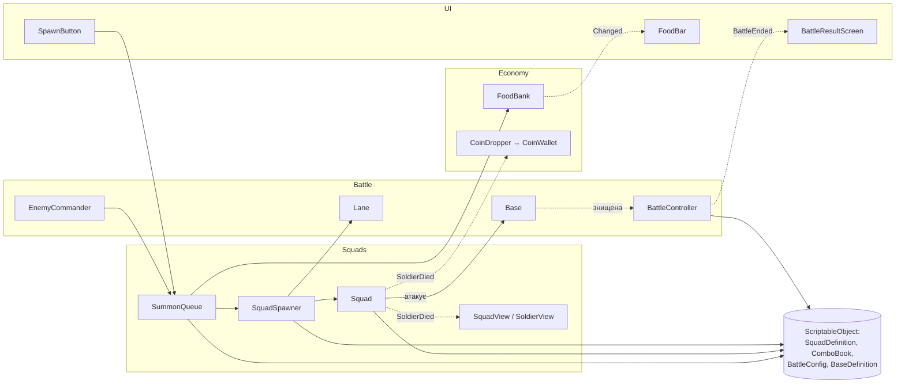

# Архітектура

> **Навіщо.** GDD описує, *що* відбувається в грі, а цей документ описує, *з яких частин* складається код
> і *хто з ким говорить*. Читай його перед тим, як додавати новий скрипт: він підкаже, в яку систему
> скрипт належить і з чим йому можна мати зв'язок.
> Документ описує цільову картину для Етапів 1–2. Коли код розходиться з документом, оновлюємо документ.

Оновлено: 2026-10-22 · Спирається на D-001, D-002, D-004, D-006…D-010.

---

## 1. Принципи

1. **Загін це логіка, солдати це візуал (D-001).** HP, шкоду, рух і вибір цілі рахує загін.
   Солдати лише показують те, що вирішив загін.
2. **Дані окремо від коду (D-004).** Характеристики живуть у ScriptableObject-ах. Новий тип загону
   означає новий файл даних, а не новий скрипт.
3. **Залежності явні.** Посилання передаються через поля в інспекторі (`[SerializeField]`) або через
   ініціалізацію. Жодного `GameObject.Find("...")` і пошуку за іменем.
4. **Логіка не знає про відображення.** Логіка повідомляє про зміни подіями (C# `event`), а візуал і UI
   підписуються на них. Тоді логіку можна перевіряти тестами без сцени.
5. **Один скрипт, одна відповідальність.** Якщо скрипт важко назвати одним іменником, його варто розділити.
6. **Пул об'єктів для масових речей.** Солдатів, стріл, монет і ефектів буде багато, а на телефоні часте
   `Instantiate`/`Destroy` гальмує. Такі об'єкти беремо з пулу і повертаємо в нього.

## 2. Системи

| Система | Папка | Відповідає за | Основні класи |
|---|---|---|---|
| **Battle** | `Scripts/Battle` | Хід бою: старт, лінія, бази, перемога/поразка, ворожий ШІ | `BattleController`, `Lane`, `Base`, `BaseDefense`, `EnemyCommander` |
| **Squads** | `Scripts/Squads` | Виклик і комбо, загін: стан, рух, пошук цілі, бій, смерть солдатів | `SummonQueue`, `ComboBook`, `Squad`, `SquadStateMachine`, `SquadCombat`, `SquadSpawner`, `SquadView`, `SoldierView` |
| **Economy** | `Scripts/Economy` | Їжа в бою, монети з убитих солдатів | `FoodBank`, `CoinDropper`, `CoinWallet` |
| **UI** | `Scripts/UI` | Кнопки виклику, шкала їжі, екран результату | `SpawnButton`, `FoodBar`, `BattleResultScreen` |
| **Meta** | `Scripts/Meta` | Прокачка і збереження між боями (Етап 3) | `PlayerProgress`, `UpgradeService`, `SaveSystem` |

Назви класів тут орієнтовні: вони показують розподіл обов'язків, а не готовий список файлів.

### 2.1 Battle
- **`BattleController`** запускає бій, тримає посилання на інші системи сцени і вирішує, коли бій закінчено:
  бій закінчено, коли HP однієї з баз дійшло до нуля (D-010, GDD 3.7).
- **`Lane`** описує лінію бою: де стоять бази, де спавняться загони кожної сторони, напрямок руху
  (вертикальний екран: гравець знизу, ворог зверху, D-009).
- **`Base`** це база сторони з HP. Ворожі загони, що дійшли до неї, атакують її; коли HP = 0, вона
  повідомляє подію `Destroyed`.
- **`BaseDefense`** (відкривається прокачкою, D-010) стріляє по найближчому ворогу в радіусі. Він використовує
  ту саму логіку дальньої атаки, що й `SquadCombat`, з даними в `BaseDefinition`, а не власну формулу.
- **`EnemyCommander`** це ШІ супротивника. Він викликає загони **через ту саму** `SummonQueue` своєї сторони,
  що й гравець (їжа, слоти, кулдаун, комбо), тож у ШІ немає «чітерських» шляхів. Правила ШІ **[ВІДКРИТО]** (GDD 3.9).

### 2.2 Squads
- **`Squad`** це логічний об'єкт загону: сторона, тип (`SquadDefinition`), кількість живих солдатів,
  позиція на лінії. Повідомляє про зміни подіями `SoldierDied`, `StateChanged`, `Destroyed`.
- **`SummonQueue`** (одна на сторону) реалізує виклик із GDD 3.5: два слоти, відлік на додавання другого
  загону, тап «вийти зараз», спільний кулдаун. Вона питає `FoodBank` про їжу, через `ComboBook` визначає,
  який загін вийде (одиночний, подвійний чи рецепт), і просить `SquadSpawner` його створити.
- **`ComboBook`** це ScriptableObject з рецептами (розділ 3.2 нижче; рецепти в GDD 3.5). Порядок пари не важливий: рецепт шукається за
  невпорядкованою парою типів.
- **`SquadStateMachine`** відповідає за стани з GDD 3.2: `Марш → Зіткнення → Бій → (Марш | Знищення)`,
  для дальніх ще `Стрільба` перед `Бій`.
- **Пошук цілі (D-006):** найближчий ворожий загін у радіусі атаки. Ближні загони вливаються в сутичку, де вже
  б'ються інші (один загін може мати кількох супротивників); дальні зупиняються на своїй дистанції.
- **`SquadCombat`** раз на інтервал атаки завдає шкоди цілі: дальньої, поки ворог не поруч, потім ближньої.
  Розрахунок це чисті функції за D-002 і D-008:

  ```csharp
  // D-002: шкода = базова × (частка_бази + (1 − частка_бази) × живі / всього)
  public static float Damage(float baseDamage, float baseShare, int alive, int total) =>
      baseDamage * (baseShare + (1f - baseShare) * alive / total);

  // D-008: броня зрізає відсоток
  public static float AfterArmor(float damage, float armor) => damage * (1f - armor);
  ```
  Смерть солдатів (D-008): `Squad` накопичує отриману шкоду; щоразу, коли накопичене ≥ `SoldierHp`,
  гине один солдат (подія `SoldierDied`), залишок переноситься.
  Окремі чисті функції (без `MonoBehaviour`) потрібні, щоб формули можна було покрити EditMode-тестами.
- **`SquadSpawner`** створює загін за `SquadDefinition` на точці спавну своєї сторони.
- **`SquadView` / `SoldierView`** це візуал: розставляють солдатів у стрій, у бою біжать до ворожого строю,
  показують ефект смерті, коли `Squad` повідомляє `SoldierDied`. Логіку вони не змінюють.
  Солдати дрібні, тож у бою ефекти замість анімацій (D-009). Порядок малювання по Y: у налаштуваннях
  2D Renderer ставимо Transparency Sort Axis = (0, 1, 0), тоді нижчий спрайт малюється поверх вищого.

### 2.3 Economy
- **`FoodBank`** (одна на сторону) відновлює їжу з часом, дозволяє витратити її (`TrySpend(cost)`) і
  повідомляє про зміну (`Changed`).
- **`CoinDropper`** слухає смерть ворожих солдатів і з шансом із даних нараховує монети.
- **`CoinWallet`** зберігає монети за бій; після бою їх забирає Meta.

### 2.4 UI
UI лише **читає** стан і **передає наміри гравця**. `SpawnButton` передає вибраний тип у `SummonQueue`
і показує, чи вистачає їжі та чи йде кулдаун. `SummonSlotsView` показує слоти, відлік і підказку рецепту;
тап по слоту = «вийти зараз». UI сам не створює загони й не міняє їжу.

### 2.5 Meta (Етап 3)
Прокачка і збереження. Як саме влаштована прогресія, залежить від D-003 **[ВІДКРИТО]**, тому тут
лише одне правило: прокачка **не змінює** ScriptableObject-и, а додає модифікатори поверх них (див. 3.5).
Що вже відомо про прокачку (GDD 4): HP бази, захист бази, швидкість їжі, відкриття типів і рецептів.

## 3. Дані (ScriptableObject)

ScriptableObject це файл даних у проєкті (`.asset`), який редагується в інспекторі, як компонент,
але не прив'язаний до сцени. Один файл = один тип загону або один набір налаштувань.

### 3.1 `SquadDefinition`: тип загону
Файли: `Data/Squads/Infantry.asset`, `Data/Squads/Archers.asset` тощо.

| Поле | Тип | Звідки в GDD |
|---|---|---|
| `DisplayName`, `Icon` | string, Sprite | Кнопка виклику |
| `FoodCost` | int | 3.5–3.6, ціна виклику |
| `SoldierCount` | int | 3.4, «всього» у формулі D-002 |
| `SoldierHp` | float | 3.4, D-008 |
| `MeleeDamage` | float | 3.4, ближня атака (є в усіх) |
| `RangedDamage` | float, 0 для ближніх | 3.4, дальня атака |
| `BaseDamageShare` | float 0–1, стартово 0.5 | D-002, «частка бази» |
| `Armor` | float 0–0.8 | D-008 |
| `AttackRange` | float | 3.3, дальні б'ють з дистанції |
| `AttackInterval` | float | Темп бою |
| `ClashDuration` | float | 3.2, фаза зіткнення перед боєм |
| `MoveSpeed` | float | Марш |
| `CoinDropChance` | float 0–1 | 3.8, монети з убитих солдатів |
| `SoldierPrefab` | GameObject | Лише візуал солдата (D-001) |

Піхота, лучники, щитоносці й вершники, а також рецепти комбо (важкі лучники, важка піхота) відрізняються лише
значеннями цих полів. Новий клас потрібен тільки тоді, коли тип має справді нову поведінку, а не нові числа:
наприклад, колісниці (таран, потім висадка).

### 3.2 `ComboBook`: рецепти комбо
Файл: `Data/Squads/ComboBook.asset`. Список записів «тип A + тип B → `SquadDefinition` результату».
Пара невпорядкована. Подвоєння однакових типів рецепта не потребує: це той самий `SquadDefinition`
з кількістю солдатів × `DoubleMultiplier`.

### 3.3 `BattleConfig`: налаштування бою
Файл: `Data/Battle/BattleConfig.asset`. Довжина лінії, стартова їжа, швидкість відновлення їжі,
доступні гравцеві загони, відлік слота (1.5 с), кулдаун виклику (3 с), `DoubleMultiplier` (2.0),
посилання на `BaseDefinition` кожної сторони (саме HP живе там, 3.4), налаштування ШІ. Пізніше з цього виросте опис рівня/епохи (D-003).

### 3.4 `BaseDefinition`: база
HP і параметри захисту (дальня шкода, радіус, інтервал). Прокачка додає модифікатори поверх (див. 3.5).

### 3.5 Правило: дані тільки читаються
Під час гри ScriptableObject-и **не змінюються**. Поточний стан (скільки солдатів живі, скільки їжі)
живе в `Squad` і `FoodBank`. Причина: зміни, зроблені в SO у Play mode в редакторі, зберігаються у файлі
назавжди, і баланс тихо «попливе». Прокачка (Meta) рахує підсумкове значення як
«дані SO + модифікатори гравця», не переписуючи сам SO.

## 4. Хто з ким говорить

Стрілка означає «знає про і викликає». Пунктир означає «підписується на подію».



**Напрямок залежностей:** `UI → Battle / Squads / Economy → Data`. Нижчі шари не знають про вищі:
`Squad` не знає про UI, `FoodBank` не знає про кнопки. Якщо нижчому шару треба щось повідомити,
він робить це подією.

**Хто з'єднує системи.** У сцені бою є один об'єкт `BattleController`. Він тримає посилання на системи
(призначені в інспекторі) і передає їх тим, кому вони потрібні. Це так звана *composition root*:
одне місце, де видно всі зв'язки сцени.

## 5. Структура папок

```
Assets/
  _Project/                  усе наше; решта в Assets/ від Unity і пакетів
    Scripts/
      Battle/                BattleController, Lane, Base, EnemyCommander
      Squads/                Squad, стани, бій, спавн, візуал загону й солдатів
      Economy/               FoodBank, CoinDropper, CoinWallet
      UI/                    кнопки, шкали, екран результату
      Meta/                  прокачка, збереження (Етап 3)
    Data/
      Squads/                SquadDefinition-и: Infantry.asset, Archers.asset…
      Battle/                BattleConfig.asset
    Prefabs/                 Squad, Soldier_*, Base, UI-елементи
    Tests/
      EditMode/              тести чистих функцій (формули D-002, D-008, пошук рецепта)
    Scenes/                  SampleScene (стане сценою бою), пізніше Menu
    Art/  Audio/
  Settings/                  URP-ассети і 2D Renderer (створені Unity, тут і лишаються)
```

Класи ScriptableObject (`SquadDefinition.cs`) лежать у папці своєї системи (`Scripts/Squads/`),
а файли даних (`.asset`) лежать у `Data/`.

**Assembly definitions.** Щоб EditMode-тести бачили код, у `Scripts/` лежить `TugOfWar.asmdef`, а в
`Tests/EditMode/` лежить `TugOfWar.Tests.EditMode.asmdef` з посиланням на нього. Побічний плюс: Unity
перекомпілює лише змінену збірку, і це швидше.

## 6. Відкриті питання, що впливають на архітектуру

| Питання | Де | Що від нього залежить |
|---|---|---|
| Правила ворожого ШІ | GDD 3.9 | `EnemyCommander` |
| Довгострокова прогресія | D-003 | Meta, перетворення `BattleConfig` на рівні/епохи |
| Масштаб: довжина лінії, розмір загону, швидкості | GDD 6 | `Lane`, `BattleConfig`, камера |
| Третій слот виклику | GDD 3.5 | `SummonQueue`, `ComboBook` |
